<p align="center"><a href="https://gridselect.im/demo/"></a></p>

# GridSelect

[](https://www.npmjs.com/package/@emmgeede/gridselect)
[](https://github.com/emmgeede/gridselect/actions/workflows/ci.yml)
[](https://github.com/emmgeede/gridselect/actions/workflows/accessibility.yml)
[](https://bundlejs.com/?q=@emmgeede/gridselect)
[](LICENSE)

A dependency-free JavaScript component for picking from a list of choices.
You write a plain radio group, checkbox group or `<select>`, wrap it, and
GridSelect does the rest. Short lists stay visible as items. Longer lists
switch to a compact field that opens a panel with a search input and a
multi-column grid, fully keyboard accessible. Typing filters the items, or
highlights matches in place, and digits pick an entry directly.

Your markup stays native, so forms submit, reset and validate as usual, and
everything still works without JavaScript.

**[Try the demo](https://gridselect.im/demo/)**

<a href="https://gridselect.im/demo/">
<picture>
  <source media="(prefers-color-scheme: dark)" srcset="https://raw.githubusercontent.com/emmgeede/gridselect/main/assets/filter-dark.png?v=5">
  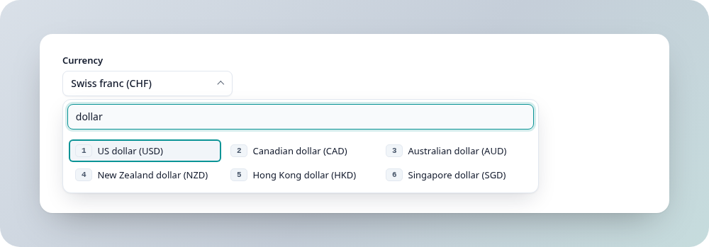
</picture>
</a>

<sub><b>Long list, filter mode (default).</b> The field opened a panel with 40 currencies. Typing
"dollar" hides everything else and renumbers the six matches 1 to 6. The outlined item is the
cursor: Enter, a click or its digit picks it.</sub>

<a href="https://gridselect.im/demo/">
<picture>
  <source media="(prefers-color-scheme: dark)" srcset="https://raw.githubusercontent.com/emmgeede/gridselect/main/assets/short-dark.png?v=5">
  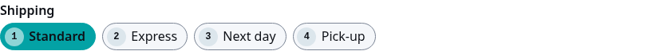
</picture>
</a>

<sub><b>Short list.</b> Up to 10 entries stay visible as items. They are native radio buttons
underneath; arrow keys move between them and the digits 1 to 4 pick one directly.</sub>

<a href="https://gridselect.im/demo/">
<picture>
  <source media="(prefers-color-scheme: dark)" srcset="https://raw.githubusercontent.com/emmgeede/gridselect/main/assets/highlight-dark.png?v=5">
  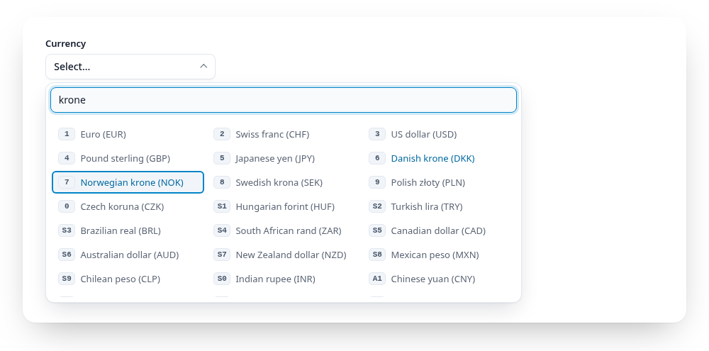
</picture>
</a>

<sub><b>Long list, highlight mode</b> (<code>data-search="highlight"</code>). The same list searched for
"krone". Nothing is hidden on purpose: every entry keeps its place, so people who use the list
daily can rely on positions. The matches (Danish and Norwegian krone) are marked in blue, the
cursor jumps to the first match, all other entries are dimmed. Entries 11 to 20 are picked with
Shift and a digit (S1 to S0).</sub>

**Status:** version 0.18.1, early development. Published on npm as
`@emmgeede/gridselect`, because npm treats the plain name `gridselect` as too
similar to an older package. Versions
follow [Semantic Versioning](https://semver.org/). See
[Features](#features) for what works today and [CHANGELOG.md](CHANGELOG.md)
for what changed.

## Contents

- [Installation](#installation)
- [Usage](#usage)
  - [Reacting to changes](#reacting-to-changes)
  - [Several at once](#several-at-once)
- [`<grid-select>`](#grid-select)
- [React and Vue](#react-and-vue)
  - [React](#react)
  - [Vue](#vue)
  - [Svelte, Angular and others](#svelte-angular-and-others)
- [API](#api)
  - [`gridselect(wrapper, options?)`](#gridselectwrapper-options)
  - [Options](#options)
  - [Above the threshold](#above-the-threshold)
  - [Entries from JavaScript](#entries-from-javascript)
  - [Multiple choice](#multiple-choice)
  - [Groups](#groups)
  - [Pinned and recent entries](#pinned-and-recent-entries)
  - [Descriptions](#descriptions)
  - [`<select>` as source](#select-as-source)
  - [Search](#search)
  - [`instance.value`](#instancevalue)
  - [`instance.setItems(items)`](#instancesetitemsitems)
  - [`instance.destroy()`](#instancedestroy)
  - [TypeScript](#typescript)
- [Styling](#styling)
  - [Themes](#themes)
- [Keyboard](#keyboard)
  - [Digit shortcuts](#digit-shortcuts)
- [Accessibility](#accessibility)
- [Features](#features)
- [Browser support](#browser-support)
- [Development](#development)
- [License](#license)

## Installation

```sh
npm install @emmgeede/gridselect
```

```js
import { gridselect } from "@emmgeede/gridselect";
import "@emmgeede/gridselect/gridselect.css"; // optional
```

Without a bundler, from a CDN (`window.gridselect`):

```html
<link rel="stylesheet" href="https://cdn.jsdelivr.net/npm/@emmgeede/gridselect@0/src/gridselect.css">
<script src="https://cdn.jsdelivr.net/npm/@emmgeede/gridselect@0/dist/gridselect.min.js"></script>
<script>
  document.querySelectorAll("[data-gridselect]").forEach((el) => gridselect(el));
</script>
```

Prefer HTML only? Use the custom element, see [`<grid-select>`](#grid-select):

```html
<script src="https://cdn.jsdelivr.net/npm/@emmgeede/gridselect@0/dist/gridselect-element.min.js"></script>
```

## Usage

```html
<fieldset data-gridselect>
  <legend>Currency</legend>
  <label><input type="radio" name="cur" value="EUR" checked> Euro</label>
  <label><input type="radio" name="cur" value="CHF"> Swiss franc</label>
</fieldset>
```

```js
import { gridselect } from "@emmgeede/gridselect";

const gs = gridselect(document.querySelector("[data-gridselect]"));
gs.value;           // "EUR"
gs.value = "CHF";   // checks the CHF radio, fires no event
```

### Reacting to changes

GridSelect keeps your inputs as the source of truth. Whenever the user picks
something, by clicking an input, using the keyboard or choosing an item in
the panel, GridSelect sets `checked` on the native input and the browser's
own `input` and `change` events fire on it. Both bubble, so one listener on
the wrapper covers the whole group:

```js
const wrapper = document.querySelector("[data-gridselect]");
const gs = gridselect(wrapper);

wrapper.addEventListener("change", (event) => {
  console.log(event.target.value); // the input that changed, e.g. "CHF"
  console.log(gs.value);           // the whole selection: "CHF", or ["a", "c"] for checkboxes
});
```

There is no custom event to learn: code that listens to `change` or `input`
with `addEventListener` keeps working unchanged. React is the exception for
picks inside the panel, because React's `onChange` on radios listens to
clicks, not to `change`. In React, attach a native listener to the wrapper
(via a ref) until the planned framework wrappers exist. Setting `gs.value` from
code fires no event, just like setting `checked` yourself, and a form
submit always sends the current selection.

### Several at once

```js
document.querySelectorAll("[data-gridselect]").forEach((el) => gridselect(el));
```

Use `forEach((el) => gridselect(el))`, not `forEach(gridselect)`: the second
form passes the index as a second argument, which will be read as options in
later versions.

A `<fieldset>` with a `<legend>` is the recommended wrapper, it gives screen
readers the group name. Any element works, `data-gridselect` is only a
convention for selecting wrappers and for the stylesheet.

## `<grid-select>`

The custom element builds everything from HTML, no JavaScript call needed:

```html
<grid-select name="destination" label="Destination" search="highlight">
  <option value="">Choose a destination…</option>
  <option value="BER">Berlin (BER)</option>
  <option value="OSL" selected>Oslo (OSL)</option>
  <option value="ZRH" disabled>Zurich (ZRH)</option>
</grid-select>

<script type="module">
  import "@emmgeede/gridselect/element"; // registers <grid-select>
</script>
```

It works in the light DOM: inside it builds a `<fieldset data-gridselect>`
with a `<legend>` and native radios (or checkboxes with `multiple`) from its
`<option>` children (also inside `<optgroup>`, see [Groups](#groups)), which it hides. So the stylesheet, the theme, forms and
screen readers work as everywhere else, and `input` and `change` bubble up
from the element.

| Attribute | Meaning |
|---|---|
| `name` | Form name of the inputs |
| `label` | Group name, becomes the `<legend>`. Without `label` or `aria-label` the console warns, a group needs a name |
| `multiple` | Checkboxes instead of radios |
| `value` | Initial choice, comma-separated with `multiple`. Without it, `selected` options count |
| `threshold`, `layout`, `search`, `match`, `placeholder`, `search-placeholder` | As the options of the same name |
| `max`, `search-description` | As the options `max` and `searchDescription` |
| `pinned`, `recent`, `recent-max`, `pinned-text`, `recent-text` | As `pinned` (comma-separated), `recent`, `recentMax`, `pinnedText`, `recentText` |
| `shortcuts` | `off`, or tiers separated by commas, e.g. `,Shift,Alt` |
| `required`, `disabled` | As on native inputs |

Properties: `el.value` reads and sets the selection like `gs.value`, and
`el.items = [...]` (format as in [Entries from JavaScript](#entries-from-javascript))
replaces the `<option>` children as source. When attributes or options change,
as frameworks do all the time, the element rebuilds and keeps the choice and
the focus. An option with an empty value is the placeholder, an option without
`value` uses its text.

In React, Vue, Svelte or Angular write `<grid-select>` like any HTML element.
For events, add a native listener (`addEventListener("change", …)`, in React
via a ref) rather than relying on framework-specific change props.

## React and Vue

Thin wrappers around `<grid-select>`, in the same package. React (18 or 19)
and Vue (3.3 or newer) are optional peer dependencies: install them only if
you use the wrapper.

### React

```jsx
import { GridSelect } from "@emmgeede/gridselect/react";
import "@emmgeede/gridselect/gridselect.css";

function CurrencyField() {
  const [currency, setCurrency] = useState("CHF");
  return (
    <GridSelect name="currency" label="Currency" items={currencies}
      value={currency} onChange={setCurrency} search="highlight" />
  );
}
```

- `value` with `onChange(value)` is a controlled field: the element always
  shows `value`. `defaultValue` makes it uncontrolled.
- `items` takes the same format as [Entries from JavaScript](#entries-from-javascript),
  groups included. `<option>` and `<optgroup>` children work too.
- The other attributes of `<grid-select>` are props in camelCase:
  `ariaLabel`, `multiple`, `threshold`, `layout`, `search`, `match`,
  `placeholder`, `searchPlaceholder`, `required`, `disabled`, `max`,
  `searchDescription`, `pinned`,
  `recent`, `recentMax`, `pinnedText`, `recentText`, and `shortcuts` as an
  array or `false`.
- `ref` points to the `<grid-select>` element.

### Vue

```vue
<script setup>
import { ref } from "vue";
import { GridSelect } from "@emmgeede/gridselect/vue";
const currency = ref("CHF");
</script>

<template>
  <GridSelect v-model="currency" name="currency" label="Currency" :items="currencies" />
</template>
```

The Vue component takes the same props, supports `v-model` and passes the
native `change` and `input` events on. If you use `<grid-select>` directly in
Vue templates, tell the compiler it is a custom element
(`compilerOptions.isCustomElement: (tag) => tag === "grid-select"`).

### Svelte, Angular and others

These frameworks use the element itself:

```svelte
<script>
  import "@emmgeede/gridselect/element";
  let currency = $state("CHF");
</script>

<grid-select name="currency" label="Currency" value={currency}
  onchange={(e) => (currency = e.currentTarget.value)}>
  <option value="EUR">Euro</option>
  <option value="CHF">Swiss franc</option>
</grid-select>
```

```ts
// Angular: allow custom elements in the component, then bind as usual
@Component({
  selector: "app-currency",
  schemas: [CUSTOM_ELEMENTS_SCHEMA],
  template: `<grid-select name="currency" label="Currency" [items]="currencies"
    (change)="currency = $any($event.currentTarget).value"></grid-select>`,
})
export class CurrencyComponent { currencies = ["EUR", "CHF"]; currency = "CHF"; }
```

## API

### `gridselect(wrapper, options?)`

Returns the instance for `wrapper`. Calling it again on the same element
returns the same instance (options of later calls are ignored).

The wrapper holds either radios with one shared `name` (single choice) or
checkboxes (multiple choice). Throws a `TypeError` if `wrapper` is not an
element, if it mixes radios and checkboxes, or if its radios have different
names. Duplicate values log a warning. For radios the first input with that
value wins, for checkboxes all of them are set.

### Options

| Option | Data attribute | Default | Meaning |
|---|---|---|---|
| `threshold` | `data-threshold` | `10` | Radio groups with more radios than this get the panel. `0` means always |
| `layout` | `data-layout` | `"grid"` | `"grid"` aligns items in columns as wide as the widest one, `"list"` stacks them in one column for long labels, `"flow"` lets them run one after another like chips |
| `placeholder` | | `"Select…"` | Field text while nothing is selected |
| `searchPlaceholder` | | `"Search…"` | Placeholder of the search input |
| `search` | `data-search` | `"filter"` | `"filter"` hides non-matches, `"highlight"` keeps every item in place and marks matches |
| `match` | `data-match-mode` | `"substring"` | `"fuzzy"` matches letters in order with gaps and words in any order, see [Search](#search) |
| `noResultsText` | | `"No matches"` | Hint (filter mode) and announcement when nothing matches |
| `resultsText` | | `n => n === 1 ? "1 result" : n + " results"` | Screen reader announcement of the match count. A function, so plural rules of any language fit |
| `selectedText` | | `n => n + " selected"` | Field text of a multiple choice group with more than two entries chosen (one or two show their labels) |
| `items` | | | Entries for an empty wrapper, see [Entries from JavaScript](#entries-from-javascript) |
| `name` | | | Form name of the inputs built from `items` |
| `value` | | | Initial choice for `items` (an array with `multiple`) |
| `multiple` | | `false` | Build checkboxes instead of radios from `items` |
| `shortcuts` | `data-shortcuts="off"` | `["", "Shift", "Alt"]` | Digit key tiers, see [Digit shortcuts](#digit-shortcuts). `false` turns them off |
| `searchDescription` | `data-search-description` | `false` | Search the entries' descriptions too, see [Descriptions](#descriptions) |
| `max` | `data-max="3"` | | Multiple choice: at most this many, see [Multiple choice](#multiple-choice) |
| `maxText` | | `n => "Maximum of " + n + " reached"` | Announcement at the limit |
| `pinned` | `data-pinned="EUR,USD"` | | Values shown again on top of the panel, see [Pinned and recent entries](#pinned-and-recent-entries) |
| `recent` | `data-recent="currency"` | off | Storage key: remember the last picks and show them on top |
| `recentMax` | `data-recent-max` | `5` | How many recent picks; `0` turns recent off |
| `pinnedText`, `recentText` | | `"Pinned"`, `"Recent"` | Headings of the two groups |

JS options win over data attributes. Invalid values fall back to the default.

### Above the threshold

GridSelect hides your radios and labels (`hidden`) but keeps them in the
form: they still submit, reset and validate, and picking an item checks the
radio and fires `input` and `change` on it, so your listeners keep working.
It adds two elements to the wrapper:

```html
<button data-gridselect-field class="gridselect__field" aria-haspopup="listbox">Euro</button>
<div data-gridselect-panel class="gridselect__panel" hidden>
  <input data-gridselect-search class="gridselect__search" role="combobox">
  <div data-gridselect-scroller class="gridselect__scroller" role="listbox">
    <div data-gridselect-items class="gridselect__items" role="presentation">
      <div data-gridselect-item class="gridselect__item" role="option" aria-selected="true" data-value="EUR">Euro</div>
      …
    </div>
  </div>
</div>
```

The scroller scrolls, the item list inside grows freely, so the stylesheet
can give every grid row the height of the tallest one.

In the `grid` layout GridSelect measures the widest item (on one line) each
time the panel opens and puts it in `--gs-auto-width` on the item list. The
stylesheet makes every column that wide, at least `--gs-item-min-width` and at
most half the list, so short labels get many columns and a single long label
never forces one column. In the `flow` layout (`.gridselect__items--flow`)
the items run one after another and wrap; arrow up and down jump to the item
in the row above or below whose centre is closest.

<a href="https://gridselect.im/demo/">
<picture>
  <source media="(prefers-color-scheme: dark)" srcset="https://raw.githubusercontent.com/emmgeede/gridselect/main/assets/layout-grid-dark.png?v=1">
  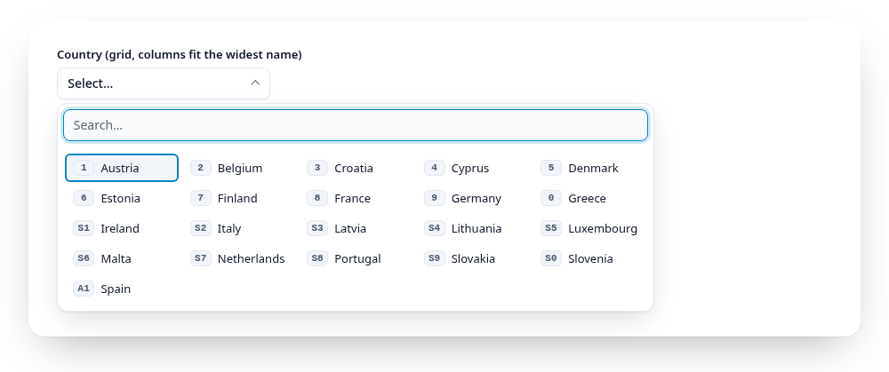
</picture>
</a>

<sub><b>Grid layout (default).</b> Every column is as wide as the widest country name, so 27 short names fit in five columns.</sub>

<a href="https://gridselect.im/demo/">
<picture>
  <source media="(prefers-color-scheme: dark)" srcset="https://raw.githubusercontent.com/emmgeede/gridselect/main/assets/layout-flow-dark.png?v=1">
  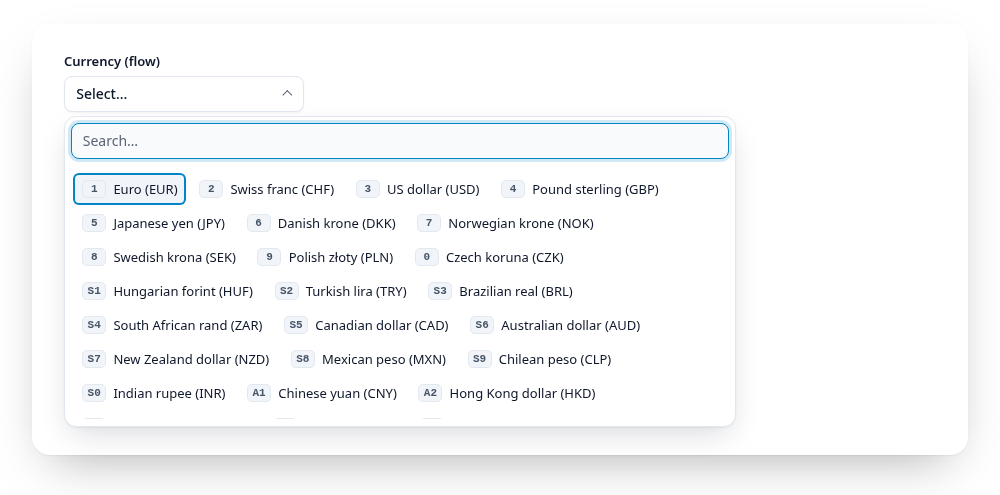
</picture>
</a>

<sub><b>Flow layout</b> (<code>data-layout="flow"</code>). Each item is as wide as its label, and the items wrap like chips.</sub>

Style the states through attributes: `[aria-expanded="true"]` on the field,
`[aria-selected="true"]` on the selected item, `[data-cursor]` on the item
the arrow keys are on, `[aria-disabled="true"]` on disabled ones, and
`.gridselect__items--list` for the list layout. The grid's column count is
read from the item list's CSS (`grid-template-columns`, e.g.
`repeat(auto-fill, minmax(6rem, 1fr))`), so arrow up/down always jump one
visual row. The optional stylesheet (see [Styling](#styling)) does all of this, or
write your own.

Item text is the label's text content. Icons or other markup inside a label
are not copied into the panel.

### Entries from JavaScript

Instead of writing inputs, pass the entries. The wrapper must be empty (a
`<legend>` is fine):

```js
const gs = gridselect(document.querySelector("#airport"), {
  name: "airport",                       // submitted under this name
  items: ["BER", { value: "FRA", label: "Frankfurt" }, { value: "MUC", label: "Munich", disabled: true }],
  value: "FRA",                          // initial choice
  multiple: false,                       // true builds checkboxes
});

gs.setItems(await loadAirports());       // swap the entries later
```

GridSelect builds native radios (or checkboxes) with labels, marked
`data-gridselect-generated`, so everything else works as with your own
markup: forms, events, panel, search and digits. Strings and numbers are
value and label at once; labels are plain text. Without `name` the inputs
still form a group but are not submitted.

`setItems()` replaces the entries in the same instance. Chosen values that
still exist stay chosen, the others are dropped, and no event fires (read
`gs.value` afterwards). Crossing the threshold switches between visible items
and the panel. Invalid entries throw a `TypeError` that names their position,
and leave the current entries untouched.

Instances built from your own markup or a select have no `setItems()`. When
you change their inputs, call `gs.destroy()` and `gridselect(el)` again.

### Multiple choice

Checkbox groups and `<select multiple>` above the threshold get the same
field and panel. The list carries `aria-multiselectable="true"`, picking an
item toggles it, fires `input` and `change` right away (like clicking a
checkbox) and keeps the panel open with the search as it was, so you can
filter for "dollar" and tick several in a row. The field shows one or two
labels, or `selectedText(n)` for more. `gs.value` is always an array.

`max` (or `data-max`) sets an upper limit, below and above the threshold.
At the limit the remaining entries get `aria-disabled="true"` and
`data-limit`: they stay focusable and readable, look muted but are not struck
through (that stays for real `disabled` entries), and cannot be ticked. A
`role="status"` region announces "Maximum of 3 reached" (`maxText(n)`) when
the limit is reached and on every blocked attempt. A start value above the
limit is kept as it is; untick entries to get below it again.

<a href="https://gridselect.im/demo/">
<picture>
  <source media="(prefers-reduced-motion: reduce) and (prefers-color-scheme: dark)" srcset="https://raw.githubusercontent.com/emmgeede/gridselect/main/assets/multiple-dark.png?v=4">
  <source media="(prefers-reduced-motion: reduce)" srcset="https://raw.githubusercontent.com/emmgeede/gridselect/main/assets/multiple-light.png?v=4">
  <source media="(prefers-color-scheme: dark)" srcset="https://raw.githubusercontent.com/emmgeede/gridselect/main/assets/multiple-dark.webp?v=4">
  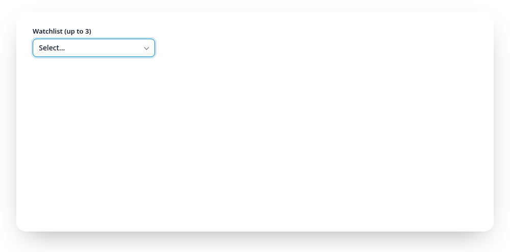
</picture>
</a>

<sub><b>Multiple choice.</b> Enter, a click or a digit ticks an item and the panel stays open with the search as it was. The field shows the labels, from three on "3 selected". With <code>data-max="3"</code> the other entries are locked after the third tick.</sub>

### Groups

Above the threshold, entries in groups get a heading in the panel. Each group
starts a new row, and its heading stays at the top while the group scrolls
by. Groups come from `<optgroup>` in a `<select>` or a `<grid-select>`, or
from group objects in `items`:

```js
gridselect(el, {
  name: "currency",
  items: [
    "USD",                                            // without a group
    { label: "Europe", items: ["EUR", { value: "CHF", label: "Swiss franc" }] },
    { label: "Asia", items: ["JPY", "CNY"] },
  ],
});
```

<a href="https://gridselect.im/demo/">
<picture>
  <source media="(prefers-color-scheme: dark)" srcset="https://raw.githubusercontent.com/emmgeede/gridselect/main/assets/groups-dark.png?v=1">
  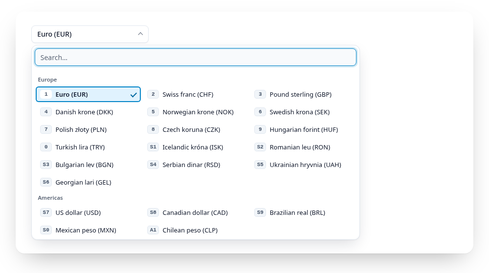
</picture>
</a>

<sub><b>Groups.</b> Each region has its own heading. The digits run on across the groups.</sub>

- Groups are one level deep. Entries without a group stay where they are,
  without a heading. Empty groups are left out.
- Arrow keys cross group borders, up and down go to the nearest entry in the
  row above or below. The cursor never lands on a heading.
- Digits run on across groups, they do not restart per group.
- In `filter` mode the groups keep their order and only the entries inside a
  group are sorted. A group without matches is hidden with its heading. The
  group name itself is not searched.
- Each group is a `role="group"` named by its heading
  (`[data-gridselect-group-label]`), so screen readers announce the group
  name when the cursor enters it. Entries of a `<optgroup disabled>` are
  disabled.
- At or below the threshold there are no headings, the entries keep their
  order.

Style hooks: `.gridselect__group` (a section of the item list, it uses the
list's columns through `subgrid`) and `.gridselect__group-label`.

### Pinned and recent entries

People who use a list every day pick the same few entries again and again.
`pinned` puts chosen values on top of the panel, `recent` adds the last
picks:

```js
gridselect(el, { pinned: ["EUR", "USD"], recent: "currency" });
```

```html
<fieldset data-gridselect data-pinned="EUR,USD" data-recent="currency"> … </fieldset>
```

<a href="https://gridselect.im/demo/">
<picture>
  <source media="(prefers-color-scheme: dark)" srcset="https://raw.githubusercontent.com/emmgeede/gridselect/main/assets/pinned-dark.png?v=2">
  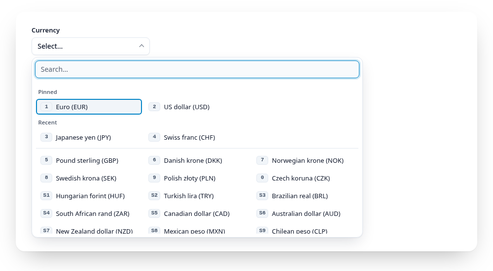
</picture>
</a>

<sub><b>Pinned and recent.</b> Two pinned entries, two recent picks, then the rest of the list. The digits run on without a gap.</sub>

- Both appear as groups ("Pinned", "Recent", change with `pinnedText` and
  `recentText`) above the list. Entries shown on top leave the list, so
  nothing appears twice.
- Digits run on from the top into the list without a gap.
- While you type, the top groups are hidden and the list holds every entry
  again, so pinned and recent entries can be found like any other.
- `recent` is off unless you set a storage key. GridSelect then keeps up to
  `recentMax` values in `localStorage` under `gridselect-recent:<key>`, only
  values that exist in the list, newest first. If storage is blocked, recent
  simply stays empty. The values are stored in the visitor's browser and can
  be personal (a city, a name): mention it in your privacy notice if so.
- Only above the threshold; short lists show everything anyway.

### Descriptions

An entry can carry a second line under its label:

```js
gridselect(el, { items: [{ value: "FR", label: "France", description: "Capital: Paris" }] });
```

```html
<option value="FR" data-description="Capital: Paris">France</option>
<label><input type="radio" name="c" value="FR"> France <small data-gridselect-description>Capital: Paris</small></label>
```

<a href="https://gridselect.im/demo/">
<picture>
  <source media="(prefers-color-scheme: dark)" srcset="https://raw.githubusercontent.com/emmgeede/gridselect/main/assets/described-dark.png?v=1">
  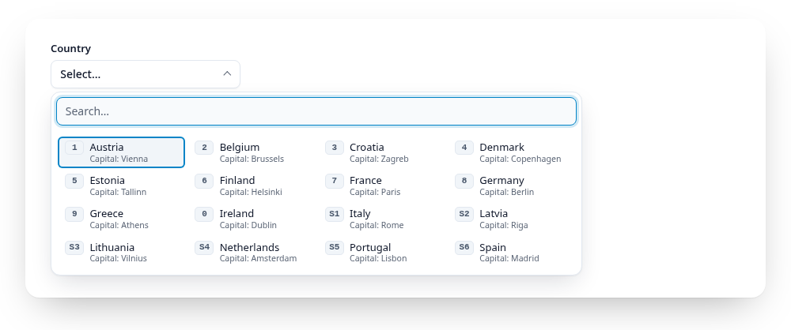
</picture>
</a>

<sub><b>Descriptions.</b> The capital under each country. With <code>data-search-description</code>, typing "paris" finds France.</sub>

- It shows in the visible entries and in the panel (also in groups and in
  pinned and recent copies), small and muted, never in the closed field.
- Screen readers hear the label as the name and the description after it
  (`aria-describedby`); the name stays short.
- The search ignores descriptions unless you set `searchDescription`
  (`data-search-description`). Then label matches still come first.
- The grid's columns follow the widest entry, descriptions included, at most
  half the list; longer descriptions wrap, and rows keep one height.
- Descriptions are plain text.

### `<select>` as source

A wrapper may hold one `<select>` instead of radios:

```html
<div data-gridselect>
  <label for="size">Size</label>
  <select id="size" name="size" required>
    <option value="">Choose a size…</option>
    <option value="s">Small</option>
    <option value="m">Medium</option>
  </select>
</div>
```

GridSelect hides the select and builds one radio per option (attribute
`data-gridselect-generated` on its label), so short selects become visible
items and long ones get the field and panel, with search and digits. The
generated radios point to no form, only the select is submitted. Picking
sets `select.value` and fires `input` and `change` on the select, so
`event.target` is the select and your existing listeners keep working.

- An option with an empty value is the placeholder: it is not an item, its
  text becomes the field text, and `gs.value` is `null` while it is chosen.
- Options inside `<optgroup>` get a heading per group above the threshold,
  see [Groups](#groups). `disabled` on options, groups and the select is
  respected, the text comes from `option.label`.
- Without a `<legend>` or `aria-label` on the wrapper, the select's own
  `<label>` names the field.
- Changes made by your code show up after a `change` event on the select or
  a form reset. `gs.value = "m"` updates everything without events.
- `<select multiple>` becomes checkboxes the same way, with the panel's
  multiple choice above the threshold. `gs.value` is an array, and the form
  submits every selected option.

### Search

Typing matches the label text (not the value), ignoring case, surrounding
spaces and accents: `zur` finds `Zürich`. Want `CHF` to be searchable? Put
it in the label, e.g. `Swiss franc (CHF)`.

- `filter` (default): non-matches get `hidden`, matches that start with the
  query come first. The cursor jumps to the first match, arrow keys walk the
  visible items only. With no match, `[data-gridselect-empty]` shows the
  `noResultsText` and Enter does nothing.
- `highlight`: items never move. Matches get `data-match`, the rest
  `data-dimmed`, the cursor jumps to the first match and arrow keys still
  reach every item, so frequent users can rely on positions.

<a href="https://gridselect.im/demo/">
<picture>
  <source media="(prefers-reduced-motion: reduce) and (prefers-color-scheme: dark)" srcset="https://raw.githubusercontent.com/emmgeede/gridselect/main/assets/search-dark.png?v=3">
  <source media="(prefers-reduced-motion: reduce)" srcset="https://raw.githubusercontent.com/emmgeede/gridselect/main/assets/search-light.png?v=3">
  <source media="(prefers-color-scheme: dark)" srcset="https://raw.githubusercontent.com/emmgeede/gridselect/main/assets/search-dark.webp?v=3">
  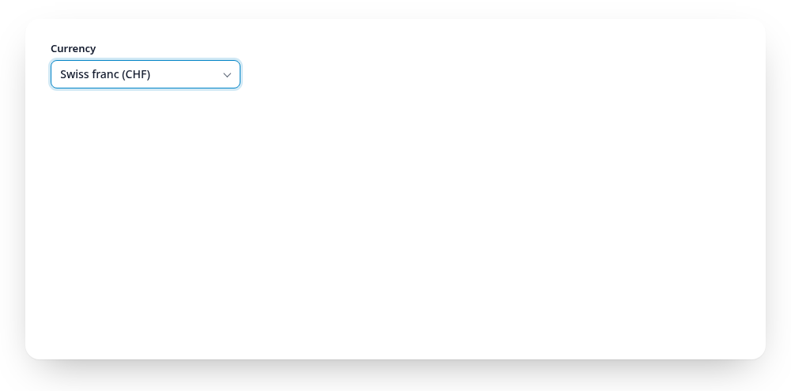
</picture>
</a>

<sub><b>Filter mode.</b> Every letter narrows the list, the matches are renumbered from 1 and the cursor stays on the first one. The highlight mode is shown at the top of this README.</sub>

With `match: "fuzzy"` (or `data-match-mode="fuzzy"`) the letters of each
word only need to appear in order, gaps allowed, and words may come in any
order: `nzd` finds "New Zealand dollar", `swfr` finds "Swiss franc", and
`franc swiss` finds it too. In filter mode better matches come first (letters
at word starts and in a row); there is no typo tolerance.

A visually hidden `[data-gridselect-status]` (`role="status"`) announces the
number of matches to screen readers. The search starts empty on every open.

The field, the search input and the listbox take their accessible name from
the wrapper's `<legend>`, `aria-labelledby` or `aria-label`. Keys pressed
during an IME composition are left to the input method. If a required group is empty on submit,
the field gets focus and `aria-invalid="true"`.

### `instance.value`

| Group | Read | Set |
|---|---|---|
| Radios | checked value, or `null` | a value checks that radio. `null` or an unknown value clears the selection |
| Checkboxes | array of checked values in DOM order, `[]` if none | an array checks exactly those values, unknown ones are ignored. Anything else throws a `TypeError` |

Numbers match their string form, so `gs.value = 2` checks the input with
`value="2"`. Any other type (arrays on a radio group, booleans, objects)
matches nothing. Setting the value fires no event, just like setting `checked` on a native
input. User changes fire the native `change` event, which bubbles up to the
wrapper:

```js
wrapper.addEventListener("change", () => console.log(gs.value));
```

### `instance.setItems(items)`

Only for instances created with `items`, see
[Entries from JavaScript](#entries-from-javascript). Throws a `TypeError`
otherwise.

### `instance.destroy()`

Forgets the instance and removes everything GridSelect added (field, panel,
`hidden` attributes, generated ids, listeners).

### TypeScript

Types ship with the package, no `@types` package needed.

## Styling

GridSelect works without any CSS of ours. For a ready look, include the
optional stylesheet:

```js
import "@emmgeede/gridselect/gridselect.css";
```

or `<link rel="stylesheet" href="…/gridselect/src/gridselect.css">` from a
CDN. It styles the wrapper's direct `<label>`s as items (the native input
stays focusable but invisible, so wrap inputs in their label), the field,
the panel, the states and the digit badges, in light and dark mode.

Everything is inside `@layer gridselect`, so any rule of your own wins, no
`!important` needed. Most changes are just variables, on `:root`, on one
wrapper, or on any ancestor:

```css
:root {
  --gs-accent: #6d28d9;
  --gs-radius: 0.5rem;
}
```

| Variable | Light | Dark | Used for |
|---|---|---|---|
| `--gs-bg` | `#ffffff` | `#171d28` | Field and panel background |
| `--gs-item-bg` | `#f5f7fa` | `#1c2433` | Item and search background |
| `--gs-fg` | `#0e1117` | `#dee4ee` | Text |
| `--gs-muted` | `#636b78` | `#9ca3af` | Dimmed items, placeholders, disabled |
| `--gs-border` | `#7a8494` | `#7e8ca0` | Borders |
| `--gs-accent` | `#03a2a5` | `#03a2a5` | Selected item, focus ring, cursor |
| `--gs-accent-fg` | `#0e1117` | `#0e1117` | Text on the accent |
| `--gs-accent-text` | `#00787b` | `#03a2a5` | Matches in highlight mode |
| `--gs-key-bg` / `--gs-key-fg` | `#dce6ec` / `#0e1117` | `#2b3646` / `#dee4ee` | Digit badge |
| `--gs-key-selected-bg` | `#8ed5d6` | `#8ed5d6` | Digit badge on the selected item |
| `--gs-invalid` | `#b91c1c` | `#f87171` | Border of an invalid field |

Sizes: `--gs-font`, `--gs-radius`, `--gs-gap`, `--gs-item-min-height`
(`2rem`), `--gs-item-padding`, `--gs-item-min-width` (`8rem`, sets the grid
columns), `--gs-focus-width`, `--gs-panel-width` (`min(40rem, 100vw - 2rem)`),
`--gs-list-max-height` (`18rem`).

All default text and border colours meet WCAG 2.2 AA contrast (4.5:1 for
text, 3:1 for borders and focus), checked by the browser tests in both
modes. If you change colours, keep those ratios. Light or dark follows the
system; `data-theme="light"` or `data-theme="dark"` on any ancestor (e.g.
`<html>`) forces one.

### Themes

A theme is one extra stylesheet, loaded after the default one. Each lives in
its own layer (`gridselect-<name>`), so your own CSS still wins. Pick one in
the [demo](https://gridselect.im/demo/) with the Theme switch.

```js
import "@emmgeede/gridselect/gridselect.css";
import "@emmgeede/gridselect/themes/high-contrast.css"; // any file in themes/
```

| Theme | For | File |
|---|---|---|
| Default | Strict WCAG 2.2 AA everywhere, 3:1 borders on every control, teal | `gridselect.css` alone |
| Showcase | A compact, contemporary look in sky blue: flat rows, check marks, keycap badges | `themes/showcase.css` |
| High contrast | Low vision: black and white, 2 px borders, 7:1 text (WCAG AAA), underlined matches | `themes/high-contrast.css` |
| Compact | Data-heavy screens: smaller, denser items, colours of the default stylesheet, items still 24 px high | `themes/compact.css` |

<table>
<tr>
<td width="50%">
<a href="https://gridselect.im/demo/"><picture>
  <source media="(prefers-color-scheme: dark)" srcset="https://raw.githubusercontent.com/emmgeede/gridselect/main/assets/theme-default-dark.png?v=1">
  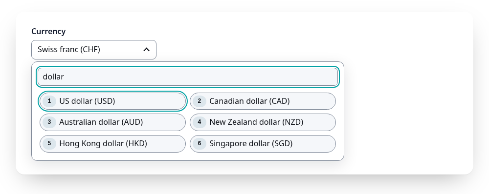
</picture></a>
<br><sub><b>Default</b></sub>
</td>
<td width="50%">
<a href="https://gridselect.im/demo/"><picture>
  <source media="(prefers-color-scheme: dark)" srcset="https://raw.githubusercontent.com/emmgeede/gridselect/main/assets/theme-showcase-dark.png?v=1">
  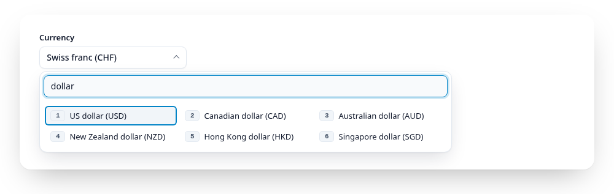
</picture></a>
<br><sub><b>Showcase</b></sub>
</td>
</tr>
<tr>
<td width="50%">
<a href="https://gridselect.im/demo/"><picture>
  <source media="(prefers-color-scheme: dark)" srcset="https://raw.githubusercontent.com/emmgeede/gridselect/main/assets/theme-high-contrast-dark.png?v=1">
  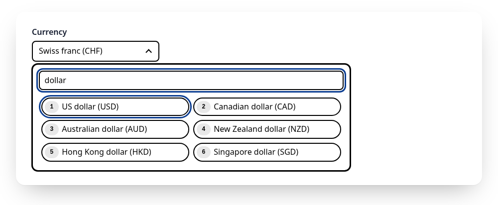
</picture></a>
<br><sub><b>High contrast</b></sub>
</td>
<td width="50%">
<a href="https://gridselect.im/demo/"><picture>
  <source media="(prefers-color-scheme: dark)" srcset="https://raw.githubusercontent.com/emmgeede/gridselect/main/assets/theme-compact-dark.png?v=1">
  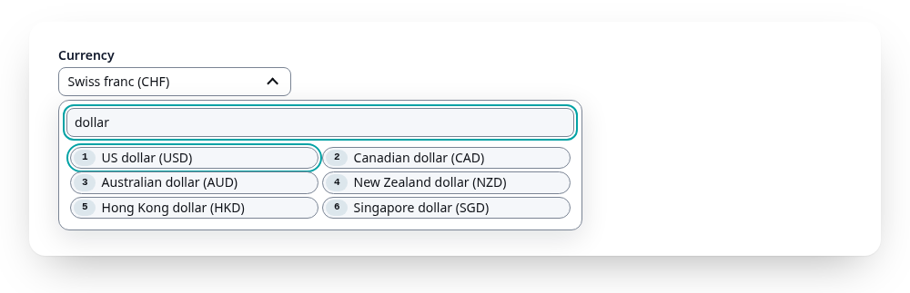
</picture></a>
<br><sub><b>Compact</b></sub>
</td>
</tr>
</table>

Every theme passes the same automatic checks in light and dark mode: axe,
4.5:1 for all text (7:1 for high contrast) and 3:1 for the chevron, the
focused search input and the cursor. Showcase keeps its resting borders
subtle: the field is recognised by its text and chevron, and the search input
shows a 3:1 border while it is focused. If you need strong borders
everywhere, use the default stylesheet alone or high contrast.

Want to add a theme? See [CONTRIBUTING.md](CONTRIBUTING.md): one file, a
header comment, its own layer, and the checks run on their own.
## Keyboard

Up to the threshold the keys are native, GridSelect only adds digits (see
below). Radios: Tab enters and leaves the group, arrow keys move and select.
Checkboxes: each checkbox is a Tab stop, Space toggles.

Above the threshold:

| Where | Key | Action |
|---|---|---|
| Field | Enter, Space, Arrow down, click | Open the panel, focus the search input. A second click closes it |
| Panel | Arrow left / right | Previous / next item (grid layout only) |
| Panel | Arrow up / down | One row up / down (one item in list layout), across group borders. Stops at the edges |
| Panel | Enter, click on an item | Pick it and close. In multiple choice: toggle it, the panel and the search stay |
| Panel | Escape | Close without change, focus back on the field |
| Panel | Tab, Shift+Tab, click outside | Close without change, focus moves on as usual |
| Panel | Digit (per tier) | Pick that item and close (toggle it in multiple choice) |

<a href="https://gridselect.im/demo/">
<picture>
  <source media="(prefers-reduced-motion: reduce) and (prefers-color-scheme: dark)" srcset="https://raw.githubusercontent.com/emmgeede/gridselect/main/assets/keyboard-dark.png?v=3">
  <source media="(prefers-reduced-motion: reduce)" srcset="https://raw.githubusercontent.com/emmgeede/gridselect/main/assets/keyboard-light.png?v=3">
  <source media="(prefers-color-scheme: dark)" srcset="https://raw.githubusercontent.com/emmgeede/gridselect/main/assets/keyboard-dark.webp?v=3">
  
</picture>
</a>

<sub><b>Keyboard.</b> Arrow keys move the outlined cursor through the grid, Enter picks the entry and closes the panel. The red badge in the bottom right corner shows the key just pressed.</sub>

### Digit shortcuts

Every entry gets a digit: 1 to 9 and 0 pick the first ten, the next tier
(Shift by default) the next ten, then Alt. Below the threshold the digits
work while the focus is in the group (a radio gets checked and focused, a
checkbox toggles). In the panel they always pick and are never typed into
the search; in `filter` mode the visible matches are renumbered from 1, in
`highlight` mode the numbers stay put.

<a href="https://gridselect.im/demo/">
<picture>
  <source media="(prefers-reduced-motion: reduce) and (prefers-color-scheme: dark)" srcset="https://raw.githubusercontent.com/emmgeede/gridselect/main/assets/digits-dark.png?v=3">
  <source media="(prefers-reduced-motion: reduce)" srcset="https://raw.githubusercontent.com/emmgeede/gridselect/main/assets/digits-light.png?v=3">
  <source media="(prefers-color-scheme: dark)" srcset="https://raw.githubusercontent.com/emmgeede/gridselect/main/assets/digits-dark.webp?v=3">
  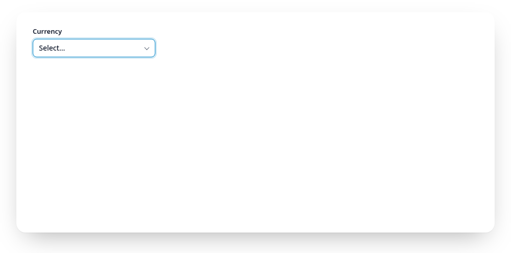
</picture>
</a>

<sub><b>Digit shortcuts.</b> The badge shows the key: 4 picks the fourth entry, Shift+3 (badge S3) the thirteenth. The panel closes right away.</sub>

```js
gridselect(el, { shortcuts: ["", "Shift", "Alt"] });      // default
gridselect(el, { shortcuts: ["Alt", "Control+Shift"] });  // plain digits stay free
gridselect(el, { shortcuts: false });                     // off
```

Tiers use `Shift`, `Alt`, `Control` and `Meta`, joined with `+`, and must
match exactly. The key's position counts, not the character, so Shift+1
works on every keyboard layout, and the number pad works too. Careful:
Ctrl+digit and Cmd+digit switch browser tabs, Alt opens menus on Windows,
and on many European layouts AltGr reports Control+Alt, so a `Control+Alt`
tier swallows characters like `{` (AltGr+7) in the search.
Labels with numbers (postcodes, years)? Use tiers without `""` or turn the
digits off, so numbers can be typed into the search.

GridSelect puts a `<span data-gridselect-key class="gridselect__key">` with
the digit at the start of each label (and of each panel item), marked
`aria-hidden` because the input gets `aria-keyshortcuts` instead. The tier is
in `data-modifiers`, and `data-prefix` holds readable letters for it (`S`
Shift, `A` Alt, `C` Control, `M` Meta, e.g. `CS` for Control+Shift), shown
before the digit with `.gridselect__key[data-prefix]::before { content:
attr(data-prefix) }`. Letters rather than symbols like ⇧, which are hard to
make out for many people. Want the digit
somewhere else or in your own form? Put an element with `data-gridselect-key`
into the label yourself: GridSelect fills it when it is empty and leaves it
alone when it has content. `destroy()` removes everything it added.

## Accessibility

GridSelect is built for WCAG 2.2 level AA:

- **Native first.** Below the threshold your radios and checkboxes stay
  native, with the browser's own semantics and keyboard handling.
- **WAI-ARIA patterns.** Above the threshold the field, the search input
  (`role="combobox"`, `aria-expanded`, `aria-activedescendant`) and the list
  (`role="listbox"`, `role="option"`, `aria-selected`, `aria-disabled`)
  follow the WAI-ARIA combobox and listbox patterns. All of them take the
  group's name from your `<legend>`, `aria-label` or `aria-labelledby`.
- **Keyboard only.** Everything works without a mouse: open, search, arrow
  keys, Enter, Escape, Tab, digits. Keys during an IME composition are left
  to the input method.
- **Announcements.** A `role="status"` region tells screen readers how many
  items match. Digit shortcuts are exposed as `aria-keyshortcuts`, the visible
  badges are `aria-hidden`.
- **Forms.** `required`, `disabled` and validation keep working, an invalid
  group moves focus to the field and sets `aria-invalid`.
- **Not by colour alone.** States come from attributes (`aria-selected`,
  `data-match`, `data-dimmed`) that styles can mark with more than colour.
  The default stylesheet meets AA contrast in light and dark mode, marks
  states with weight, outline or strike-through as well as colour, keeps
  text readable with increased text spacing and at 320 px width, and shows
  modifier keys as letters, not hard-to-read symbols.

Conformance is a property of the whole page, so a few things stay with you:
give every group a name, keep sufficient contrast if you write your own CSS,
and keep focus outlines visible. The behaviour above is covered by unit and
browser tests, and axe-core checks every state (closed, open, filtered,
highlighted, no matches, invalid) for WCAG 2.0, 2.1 and 2.2 A and AA in
light and dark mode on every push; the Accessibility badge above shows the
result. A screen reader walkthrough runs as a browser test too: it drives
every step by keyboard and checks the role, name, state and announcements
screen readers read from the accessibility tree. It runs in Chromium; it is
not a substitute for listening with Orca, NVDA or VoiceOver, which has not
been done.

## Features

| Feature | Status |
|---|---|
| Radio and checkbox groups, `value`, `destroy()`, TypeScript types | available |
| Grid panel above a configurable threshold (default 10), grid or list layout | available |
| Search modes `filter` (default) and `highlight` | available |
| Digit shortcuts with configurable modifier tiers | available |
| `<select>` as source | available |
| Optional stylesheet with CSS variables, light and dark | available |
| npm release and demo page | available |
| Multiple choice in the grid panel, `<select multiple>` | available |
| Entries from a JS array, `setItems()` | available |
| `<grid-select>` custom element | available |
| Fuzzy matching | available |
| Auto column width and flow layout | available |
| Group headings (`<optgroup>`, groups in `items`) | available |
| Pinned and recent entries | available |
| Upper limit for multiple choice (`max`) | available |
| Descriptions (a second line per entry) | available |
| Themes: showcase, high contrast, compact, open for contributions | available |
| React and Vue wrappers | available |

## Browser support

Current evergreen browsers (Chrome, Edge, Firefox, Safari).

## Development

```sh
npm install
npm test             # unit tests (Vitest + jsdom), type check, package contents
npm run test:e2e     # browser tests (Playwright, Chromium) incl. axe-core checks
npm run build        # dist/gridselect.d.ts and dist/gridselect.min.js
npm run screenshots  # README images and animations in assets/, from the demo page (needs ImageMagick)
npm run playground   # http://localhost:5173/playground/ (tests) and /demo/
```

Releases: pushing a version tag (`vX.Y.Z`, matching `package.json`) runs the
Publish workflow, which tests, builds and publishes to npm with provenance.

The playground loads `src/gridselect.js` directly and shows every variant:
short and long radio groups, checkboxes, both search modes, the list layout,
a form with `required`, `disabled`, submit and reset, and a log of the
`change` events. Its styling is provisional until the stylesheet ships.

## License

[MIT](LICENSE)
