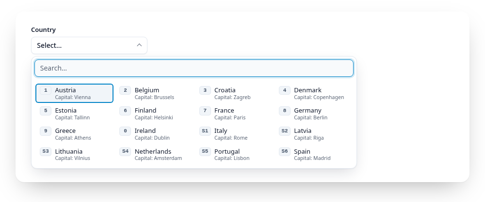

# Descriptions

<script setup>
import { currencies, regions, countries, airports, fakeLoad } from "../.vuepress/data.js";
</script>

Try `paris`:

<Example :options="{ items: countries, searchDescription: true }">
  <fieldset data-gridselect><legend>Country</legend></fieldset>
</Example>

An entry can carry a second line under its label:

```js
gridselect(el, { items: [{ value: "FR", label: "France", description: "Capital: Paris" }] });
```

```html
<option value="FR" data-description="Capital: Paris">France</option>
<label><input type="radio" name="c" value="FR"> France <small data-gridselect-description>Capital: Paris</small></label>
```

<a href="https://gridselect.im/demo/">
<picture>
  <source media="(prefers-color-scheme: dark)" srcset="https://raw.githubusercontent.com/emmgeede/gridselect/main/assets/described-dark.png?v=1">
  
</picture>
</a>

<sub><b>Descriptions.</b> The capital under each country. With <code>data-search-description</code>, typing "paris" finds France.</sub>

- It shows in the visible entries and in the panel (also in groups and in
  pinned and recent copies), small and muted, never in the closed field.
- Screen readers hear the label as the name and the description after it
  (`aria-describedby`); the name stays short.
- The search ignores descriptions unless you set `searchDescription`
  (`data-search-description`). Then label matches still come first.
- The grid's columns follow the widest entry, descriptions included, at most
  half the list; longer descriptions wrap, and rows keep one height.
- Descriptions are plain text.
