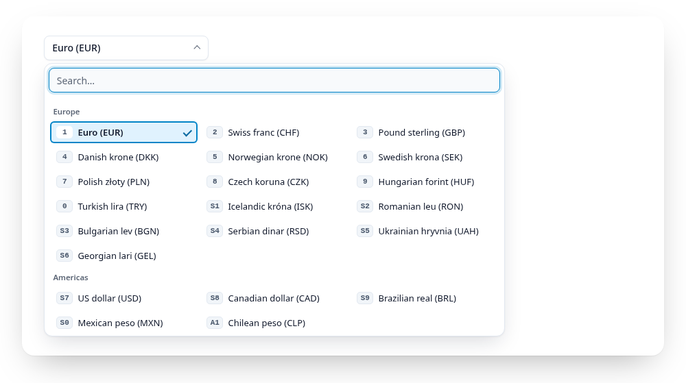

# Groups

<script setup>
import { currencies, regions, countries, airports, fakeLoad } from "../.vuepress/data.js";
</script>

<Example :options="{ items: regions }">
  <fieldset data-gridselect><legend>Currency by region</legend></fieldset>
</Example>

Above the threshold, entries in groups get a heading in the panel. Each group
starts a new row, and its heading stays at the top while the group scrolls
by. Groups come from `<optgroup>` in a `<select>` or a `<grid-select>`, or
from group objects in `items`:

```js
gridselect(el, {
  name: "currency",
  items: [
    "USD",                                            // without a group
    { label: "Europe", items: ["EUR", { value: "CHF", label: "Swiss franc" }] },
    { label: "Asia", items: ["JPY", "CNY"] },
  ],
});
```

<a href="https://gridselect.im/demo/">
<picture>
  <source media="(prefers-color-scheme: dark)" srcset="https://raw.githubusercontent.com/emmgeede/gridselect/main/assets/groups-dark.png?v=1">
  
</picture>
</a>

<sub><b>Groups.</b> Each region has its own heading. The digits run on across the groups.</sub>

- Groups are one level deep. Entries without a group stay where they are,
  without a heading. Empty groups are left out.
- Arrow keys cross group borders, up and down go to the nearest entry in the
  row above or below. The cursor never lands on a heading.
- Digits run on across groups, they do not restart per group.
- In `filter` mode the groups keep their order and only the entries inside a
  group are sorted. A group without matches is hidden with its heading. The
  group name itself is not searched.
- Each group is a `role="group"` named by its heading
  (`[data-gridselect-group-label]`), so screen readers announce the group
  name when the cursor enters it. Entries of a `<optgroup disabled>` are
  disabled.
- At or below the threshold there are no headings, the entries keep their
  order.

Style hooks: `.gridselect__group` (a section of the item list, it uses the
list's columns through `subgrid`) and `.gridselect__group-label`.
