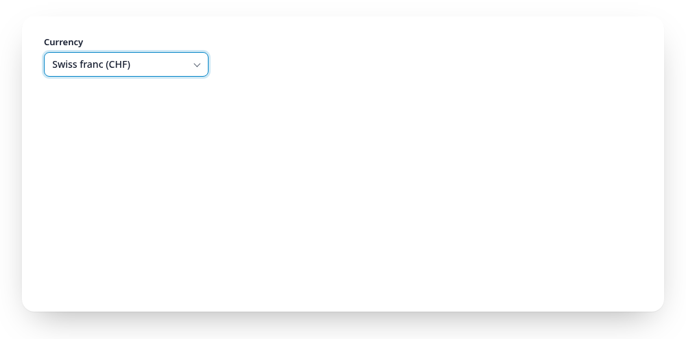
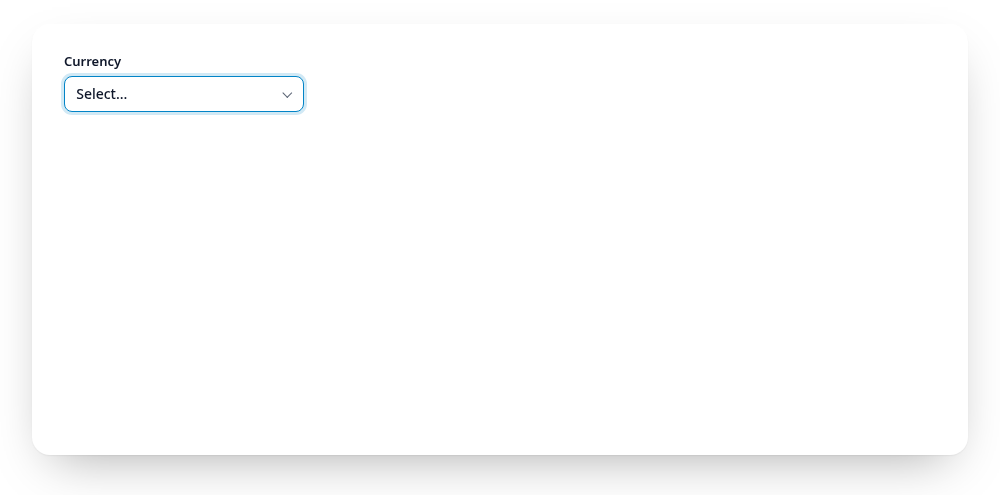

# Keyboard and digits

<script setup>
import { currencies, regions, countries, airports, fakeLoad } from "../.vuepress/data.js";
</script>

Tab to the field, Enter, arrows, a digit or Shift and a digit:

<Example :options="{ items: currencies }">
  <fieldset data-gridselect><legend>Currency</legend></fieldset>
</Example>

Up to the threshold the keys are native, GridSelect only adds digits (see
below). Radios: Tab enters and leaves the group, arrow keys move and select.
Checkboxes: each checkbox is a Tab stop, Space toggles.

Above the threshold:

| Where | Key | Action |
|---|---|---|
| Field | Enter, Space, Arrow down, click | Open the panel, focus the search input. A second click closes it |
| Panel | Arrow left / right | Previous / next item (grid layout only) |
| Panel | Arrow up / down | One row up / down (one item in list layout), across group borders. Stops at the edges |
| Panel | Enter, click on an item | Pick it and close. In multiple choice: toggle it, the panel and the search stay |
| Panel | Escape | Close without change, focus back on the field |
| Panel | Tab, Shift+Tab, click outside | Close without change, focus moves on as usual |
| Panel | Digit (per tier) | Pick that item and close (toggle it in multiple choice) |

<a href="https://gridselect.im/demo/">
<picture>
  <source media="(prefers-reduced-motion: reduce) and (prefers-color-scheme: dark)" srcset="https://raw.githubusercontent.com/emmgeede/gridselect/main/assets/keyboard-dark.png?v=3">
  <source media="(prefers-reduced-motion: reduce)" srcset="https://raw.githubusercontent.com/emmgeede/gridselect/main/assets/keyboard-light.png?v=3">
  <source media="(prefers-color-scheme: dark)" srcset="https://raw.githubusercontent.com/emmgeede/gridselect/main/assets/keyboard-dark.webp?v=3">
  
</picture>
</a>

<sub><b>Keyboard.</b> Arrow keys move the outlined cursor through the grid, Enter picks the entry and closes the panel. The red badge in the bottom right corner shows the key just pressed.</sub>

## Digit shortcuts

Every entry gets a digit: 1 to 9 and 0 pick the first ten, the next tier
(Shift by default) the next ten, then Alt. Below the threshold the digits
work while the focus is in the group (a radio gets checked and focused, a
checkbox toggles). In the panel they always pick and are never typed into
the search; in `filter` mode the visible matches are renumbered from 1, in
`highlight` mode the numbers stay put.

<a href="https://gridselect.im/demo/">
<picture>
  <source media="(prefers-reduced-motion: reduce) and (prefers-color-scheme: dark)" srcset="https://raw.githubusercontent.com/emmgeede/gridselect/main/assets/digits-dark.png?v=3">
  <source media="(prefers-reduced-motion: reduce)" srcset="https://raw.githubusercontent.com/emmgeede/gridselect/main/assets/digits-light.png?v=3">
  <source media="(prefers-color-scheme: dark)" srcset="https://raw.githubusercontent.com/emmgeede/gridselect/main/assets/digits-dark.webp?v=3">
  
</picture>
</a>

<sub><b>Digit shortcuts.</b> The badge shows the key: 4 picks the fourth entry, Shift+3 (badge S3) the thirteenth. The panel closes right away.</sub>

```js
gridselect(el, { shortcuts: ["", "Shift", "Alt"] });      // default
gridselect(el, { shortcuts: ["Alt", "Control+Shift"] });  // plain digits stay free
gridselect(el, { shortcuts: false });                     // off
```

Tiers use `Shift`, `Alt`, `Control` and `Meta`, joined with `+`, and must
match exactly. The key's position counts, not the character, so Shift+1
works on every keyboard layout, and the number pad works too. Careful:
Ctrl+digit and Cmd+digit switch browser tabs, Alt opens menus on Windows,
and on many European layouts AltGr reports Control+Alt, so a `Control+Alt`
tier swallows characters like `{` (AltGr+7) in the search.
Labels with numbers (postcodes, years)? Use tiers without `""` or turn the
digits off, so numbers can be typed into the search.

GridSelect puts a `<span data-gridselect-key class="gridselect__key">` with
the digit at the start of each label (and of each panel item), marked
`aria-hidden` because the input gets `aria-keyshortcuts` instead. The tier is
in `data-modifiers`, and `data-prefix` holds readable letters for it (`S`
Shift, `A` Alt, `C` Control, `M` Meta, e.g. `CS` for Control+Shift), shown
before the digit with `.gridselect__key[data-prefix]::before { content:
attr(data-prefix) }`. Letters rather than symbols like ⇧, which are hard to
make out for many people. Want the digit
somewhere else or in your own form? Put an element with `data-gridselect-key`
into the label yourself: GridSelect fills it when it is empty and leaves it
alone when it has content. `destroy()` removes everything it added.
