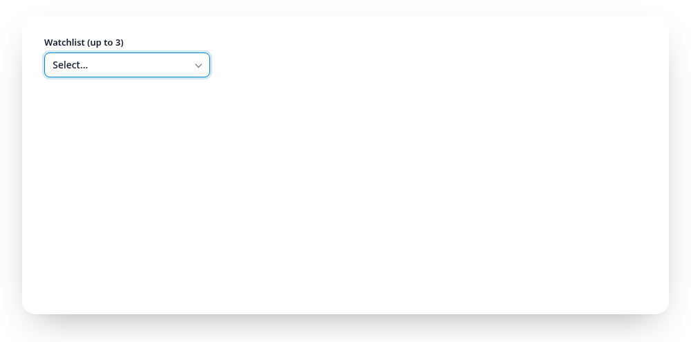

# Multiple choice

At most three:

<Example :options="{ items: currencies, multiple: true, max: 3 }">
  <fieldset data-gridselect><legend>Watchlist</legend></fieldset>
</Example>

Checkbox groups and `<select multiple>` above the threshold get the same
field and panel. The list carries `aria-multiselectable="true"`, picking an
item toggles it, fires `input` and `change` right away (like clicking a
checkbox) and keeps the panel open with the search as it was, so you can
filter for "dollar" and tick several in a row. The field shows one or two
labels, or `selectedText(n)` for more. `gs.value` is always an array.

`max` (or `data-max`) sets an upper limit, below and above the threshold.
At the limit the remaining entries get `aria-disabled="true"` and
`data-limit`: they stay focusable and readable, look muted but are not struck
through (that stays for real `disabled` entries), and cannot be ticked. A
`role="status"` region announces "Maximum of 3 reached" (`maxText(n)`) when
the limit is reached and on every blocked attempt. A start value above the
limit is kept as it is; untick entries to get below it again.

<a href="https://gridselect.im/demo/">
<picture>
  <source media="(prefers-reduced-motion: reduce) and (prefers-color-scheme: dark)" srcset="https://raw.githubusercontent.com/emmgeede/gridselect/main/assets/multiple-dark.png?v=4">
  <source media="(prefers-reduced-motion: reduce)" srcset="https://raw.githubusercontent.com/emmgeede/gridselect/main/assets/multiple-light.png?v=4">
  <source media="(prefers-color-scheme: dark)" srcset="https://raw.githubusercontent.com/emmgeede/gridselect/main/assets/multiple-dark.webp?v=4">
  
</picture>
</a>

<b>Multiple choice.</b> Enter, a click or a digit ticks an item and the panel stays open with the search as it was. The field shows the labels, from three on "3 selected". With <code>data-max="3"</code> the other entries are locked after the third tick.
