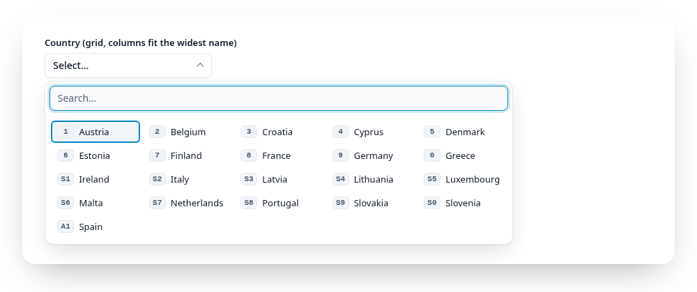
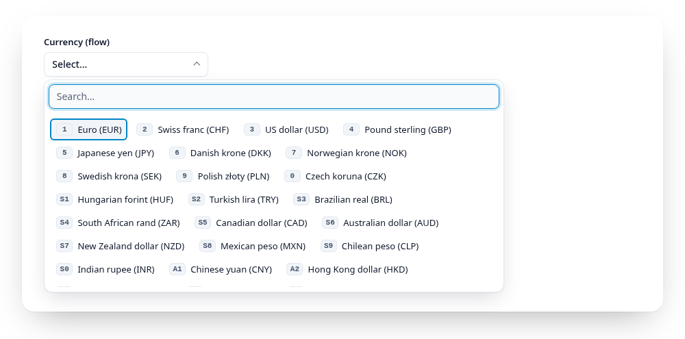

# The panel

<script setup>
import { currencies, regions, countries, airports, fakeLoad } from "../.vuepress/data.js";
</script>

Above the threshold (10 entries by default) a field opens a panel: full window width, as tall as there is room.

<Example :options="{ items: currencies, value: 'CHF' }">
  <fieldset data-gridselect><legend>Currency</legend></fieldset>
</Example>

The narrow variant (`panelWidth: "fixed"`):

<Example :options="{ items: currencies, panelWidth: 'fixed' }">
  <fieldset data-gridselect><legend>Currency (narrow)</legend></fieldset>
</Example>

GridSelect hides your radios and labels (`hidden`) but keeps them in the
form: they still submit, reset and validate, and picking an item checks the
radio and fires `input` and `change` on it, so your listeners keep working.
It adds two elements to the wrapper:

```html
<button data-gridselect-field class="gridselect__field" aria-haspopup="listbox">Euro</button>
<div data-gridselect-panel class="gridselect__panel" hidden>
  <input data-gridselect-search class="gridselect__search" role="combobox">
  <div data-gridselect-scroller class="gridselect__scroller" role="listbox">
    <div data-gridselect-items class="gridselect__items" role="presentation">
      <div data-gridselect-item class="gridselect__item" role="option" aria-selected="true" data-value="EUR">Euro</div>
      …
    </div>
  </div>
</div>
```

The scroller scrolls, the item list inside grows freely, so the stylesheet
can give every grid row the height of the tallest one.

How wide the panel gets depends on `panelWidth`:

- `"full"` (default): the panel spans the window, 10 px from each edge, so
  as many columns as possible fit. When all entries fit in one row it is
  only as wide as they need and starts under the field. Cap it with the
  CSS variable `--gs-panel-max-width` (e.g. `60rem`).
- `"fixed"` (`data-panel-width="fixed"`): `--gs-panel-width` (40rem in the
  default stylesheet), from the field's edge.

Where the panel opens and how tall it gets depends on `panelHeight`:

- `"auto"` (default): each time it opens, GridSelect checks the room below
  and above the field. If the whole content fits below, it opens below;
  otherwise towards the side with more room (then the panel carries
  `data-placement="top"`). The list grows up to 8 px before the window edge
  but never beyond its content, so short lists stay short and long ones show
  as much as fits. With less than 10rem on both sides it opens below with
  10rem. Scrolling the page or resizing the window while it is open places
  it again.
- `"fixed"` (`data-panel-height="fixed"`): always below, the list at most
  `--gs-list-max-height` high (18rem in the default stylesheet).

In the `grid` layout GridSelect measures the widest item (on one line) each
time the panel opens and puts it in `--gs-auto-width` on the item list. The
stylesheet makes every column that wide, at least `--gs-item-min-width` and at
most half the list, so short labels get many columns and a single long label
never forces one column. In the `flow` layout (`.gridselect__items--flow`)
the items run one after another and wrap; arrow up and down jump to the item
in the row above or below whose centre is closest.

<a href="https://gridselect.im/demo/">
<picture>
  <source media="(prefers-color-scheme: dark)" srcset="https://raw.githubusercontent.com/emmgeede/gridselect/main/assets/layout-grid-dark.png?v=1">
  
</picture>
</a>

<sub><b>Grid layout (default).</b> Every column is as wide as the widest country name, so 27 short names fit in five columns.</sub>

<a href="https://gridselect.im/demo/">
<picture>
  <source media="(prefers-color-scheme: dark)" srcset="https://raw.githubusercontent.com/emmgeede/gridselect/main/assets/layout-flow-dark.png?v=1">
  
</picture>
</a>

<sub><b>Flow layout</b> (<code>data-layout="flow"</code>). Each item is as wide as its label, and the items wrap like chips.</sub>

Style the states through attributes: `[aria-expanded="true"]` on the field,
`[aria-selected="true"]` on the selected item, `[data-cursor]` on the item
the arrow keys are on, `[aria-disabled="true"]` on disabled ones, and
`.gridselect__items--list` for the list layout. The grid's column count is
read from the item list's CSS (`grid-template-columns`, e.g.
`repeat(auto-fill, minmax(6rem, 1fr))`), so arrow up/down always jump one
visual row. The optional stylesheet (see [Styling](/guide/styling.md)) does all of this, or
write your own.

Item text is the label's text content. Icons or other markup inside a label
are not copied into the panel.
