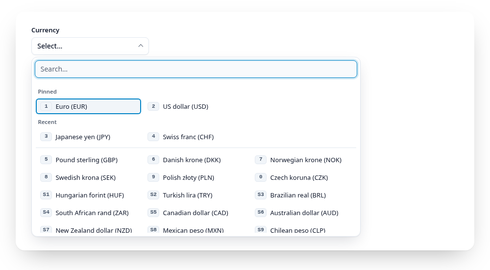

# Pinned and recent entries

<script setup>
import { currencies, regions, countries, airports, fakeLoad } from "../.vuepress/data.js";
</script>

Pick a few entries, then open the panel again:

<Example :options="{ items: currencies, pinned: ['EUR', 'USD'], recent: 'docs-currency' }">
  <fieldset data-gridselect><legend>Currency</legend></fieldset>
</Example>

People who use a list every day pick the same few entries again and again.
`pinned` puts chosen values on top of the panel, `recent` adds the last
picks:

```js
gridselect(el, { pinned: ["EUR", "USD"], recent: "currency" });
```

```html
<fieldset data-gridselect data-pinned="EUR,USD" data-recent="currency"> … </fieldset>
```

<a href="https://gridselect.im/demo/">
<picture>
  <source media="(prefers-color-scheme: dark)" srcset="https://raw.githubusercontent.com/emmgeede/gridselect/main/assets/pinned-dark.png?v=2">
  
</picture>
</a>

<sub><b>Pinned and recent.</b> Two pinned entries, two recent picks, then the rest of the list. The digits run on without a gap.</sub>

- Both appear as groups ("Pinned", "Recent", change with `pinnedText` and
  `recentText`) above the list. Entries shown on top leave the list, so
  nothing appears twice.
- Digits run on from the top into the list without a gap.
- While you type, the top groups are hidden and the list holds every entry
  again, so pinned and recent entries can be found like any other.
- `recent` is off unless you set a storage key. GridSelect then keeps up to
  `recentMax` values in `localStorage` under `gridselect-recent:<key>`, only
  values that exist in the list, newest first. If storage is blocked, recent
  simply stays empty. The values are stored in the visitor's browser and can
  be personal (a city, a name): mention it in your privacy notice if so.
- Only above the threshold; short lists show everything anyway.
