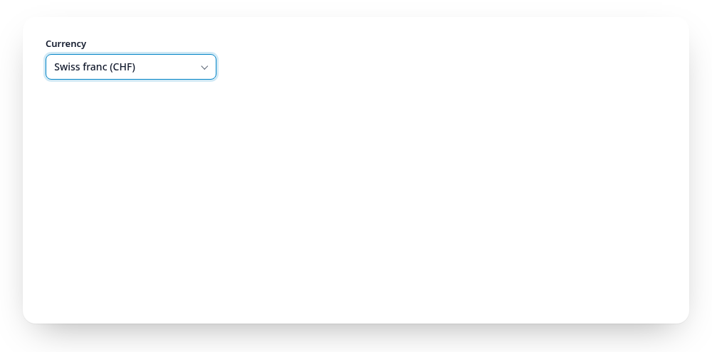

# Search

Filter mode (default), try `dollar`:

<Example :options="{ items: currencies }">
  <fieldset data-gridselect><legend>Currency</legend></fieldset>
</Example>

Highlight mode with fuzzy matching, try `krone` or `nzd`:

<Example :options="{ items: currencies, search: 'highlight', match: 'fuzzy' }">
  <fieldset data-gridselect><legend>Currency</legend></fieldset>
</Example>

Typing matches the label text (not the value), ignoring case, surrounding
spaces and accents: `zur` finds `Zürich`. Want `CHF` to be searchable? Put
it in the label, e.g. `Swiss franc (CHF)`.

- `filter` (default): non-matches get `hidden`, matches that start with the
  query come first. The cursor jumps to the first match, arrow keys walk the
  visible items only. With no match, `[data-gridselect-empty]` shows the
  `noResultsText` and Enter does nothing.
- `highlight`: items never move. Matches get `data-match`, the rest
  `data-dimmed`, the cursor jumps to the first match and arrow keys still
  reach every item, so frequent users can rely on positions.

<a href="https://gridselect.im/demo/">
<picture>
  <source media="(prefers-reduced-motion: reduce) and (prefers-color-scheme: dark)" srcset="https://raw.githubusercontent.com/emmgeede/gridselect/main/assets/search-dark.png?v=3">
  <source media="(prefers-reduced-motion: reduce)" srcset="https://raw.githubusercontent.com/emmgeede/gridselect/main/assets/search-light.png?v=3">
  <source media="(prefers-color-scheme: dark)" srcset="https://raw.githubusercontent.com/emmgeede/gridselect/main/assets/search-dark.webp?v=3">
  
</picture>
</a>

<b>Filter mode.</b> Every letter narrows the list, the matches are renumbered from 1 and the cursor stays on the first one. The highlight mode is shown at the top of this README.

With `match: "fuzzy"` (or `data-match-mode="fuzzy"`) the letters of each
word only need to appear in order, gaps allowed, and words may come in any
order: `nzd` finds "New Zealand dollar", `swfr` finds "Swiss franc", and
`franc swiss` finds it too. In filter mode better matches come first (letters
at word starts and in a row); there is no typo tolerance.

A visually hidden `[data-gridselect-status]` (`role="status"`) announces the
number of matches to screen readers. The search starts empty on every open.

The field, the search input and the listbox take their accessible name from
the wrapper's `<legend>`, `aria-labelledby` or `aria-label`. Keys pressed
during an IME composition are left to the input method. If a required group is empty on submit,
the field gets focus and `aria-invalid="true"`.
