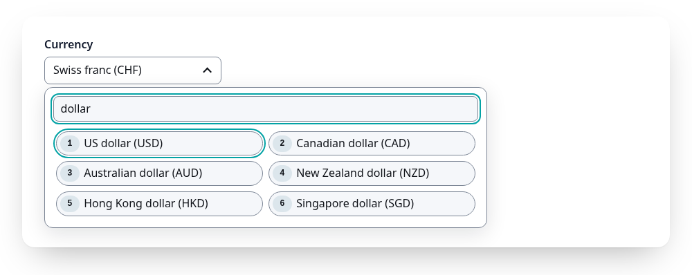
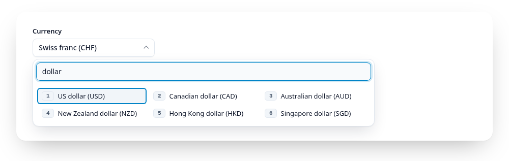
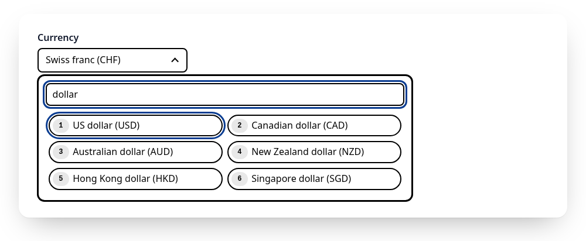
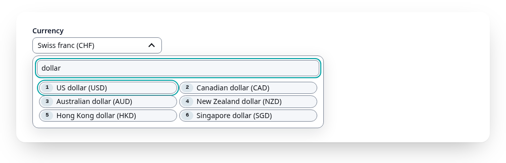

# Styling and themes

The examples in this documentation use the showcase theme (see below). Variables on any ancestor change the look; here `--gs-accent` and `--gs-radius`:

<Example>
  <fieldset data-gridselect style="--gs-accent: #7c3aed; --gs-accent-fg: #ffffff; --gs-radius: 6px">
    <legend>Size</legend>
    <label><input type="radio" name="size" value="s"> Small</label>
    <label><input type="radio" name="size" value="m" checked> Medium</label>
    <label><input type="radio" name="size" value="l"> Large</label>
  </fieldset>
</Example>

All themes side by side: the Theme switch on the [demo](https://gridselect.im/demo/).

GridSelect works without any CSS of ours. For a ready look, include the
optional stylesheet:

```js
import "@emmgeede/gridselect/gridselect.css";
```

or `<link rel="stylesheet" href="…/gridselect/src/gridselect.css">` from a
CDN. It styles the wrapper's direct `<label>`s as items (the native input
stays focusable but invisible, so wrap inputs in their label), the field,
the panel, the states and the digit badges, in light and dark mode.

Everything is inside `@layer gridselect`, so any rule of your own wins, no
`!important` needed. Most changes are just variables, on `:root`, on one
wrapper, or on any ancestor:

```css
:root {
  --gs-accent: #6d28d9;
  --gs-radius: 0.5rem;
}
```

| Variable | Light | Dark | Used for |
|---|---|---|---|
| `--gs-bg` | `#ffffff` | `#171d28` | Field and panel background |
| `--gs-item-bg` | `#f5f7fa` | `#1c2433` | Item and search background |
| `--gs-fg` | `#0e1117` | `#dee4ee` | Text |
| `--gs-muted` | `#636b78` | `#9ca3af` | Dimmed items, placeholders, disabled |
| `--gs-border` | `#7a8494` | `#7e8ca0` | Borders |
| `--gs-accent` | `#03a2a5` | `#03a2a5` | Selected item, focus ring, cursor |
| `--gs-accent-fg` | `#0e1117` | `#0e1117` | Text on the accent |
| `--gs-accent-text` | `#00787b` | `#03a2a5` | Matches in highlight mode |
| `--gs-key-bg` / `--gs-key-fg` | `#dce6ec` / `#0e1117` | `#2b3646` / `#dee4ee` | Digit badge |
| `--gs-key-selected-bg` | `#8ed5d6` | `#8ed5d6` | Digit badge on the selected item |
| `--gs-invalid` | `#b91c1c` | `#f87171` | Border of an invalid field |

Sizes: `--gs-font`, `--gs-radius`, `--gs-gap`, `--gs-item-min-height`
(`2rem`), `--gs-item-padding`, `--gs-item-min-width` (`8rem`, sets the grid
columns), `--gs-focus-width`, `--gs-panel-width` (`min(40rem, 100vw - 2rem)`),
`--gs-list-max-height` (`18rem`).

All default text and border colours meet WCAG 2.2 AA contrast (4.5:1 for
text, 3:1 for borders and focus), checked by the browser tests in both
modes. If you change colours, keep those ratios. Light or dark follows the
system; `data-theme="light"` or `data-theme="dark"` on any ancestor (e.g.
`<html>`) forces one.

A theme is one extra stylesheet, loaded after the default one. Each lives in
its own layer (`gridselect-<name>`), so your own CSS still wins. Pick one in
the [demo](https://gridselect.im/demo/) with the Theme switch.

```js
import "@emmgeede/gridselect/gridselect.css";
import "@emmgeede/gridselect/themes/high-contrast.css"; // any file in themes/
```

| Theme | For | File |
|---|---|---|
| Default | Strict WCAG 2.2 AA everywhere, 3:1 borders on every control, teal | `gridselect.css` alone |
| Showcase | A compact, contemporary look in sky blue: flat rows, check marks, keycap badges | `themes/showcase.css` |
| High contrast | Low vision: black and white, 2 px borders, 7:1 text (WCAG AAA), underlined matches | `themes/high-contrast.css` |
| Compact | Data-heavy screens: smaller, denser items, colours of the default stylesheet, items still 24 px high | `themes/compact.css` |

<table>
<tr>
<td width="50%">
<a href="https://gridselect.im/demo/"><picture>
  <source media="(prefers-color-scheme: dark)" srcset="https://raw.githubusercontent.com/emmgeede/gridselect/main/assets/theme-default-dark.png?v=1">
  
</picture></a>
<br><sub><b>Default</b></sub>
</td>
<td width="50%">
<a href="https://gridselect.im/demo/"><picture>
  <source media="(prefers-color-scheme: dark)" srcset="https://raw.githubusercontent.com/emmgeede/gridselect/main/assets/theme-showcase-dark.png?v=1">
  
</picture></a>
<br><sub><b>Showcase</b></sub>
</td>
</tr>
<tr>
<td width="50%">
<a href="https://gridselect.im/demo/"><picture>
  <source media="(prefers-color-scheme: dark)" srcset="https://raw.githubusercontent.com/emmgeede/gridselect/main/assets/theme-high-contrast-dark.png?v=1">
  
</picture></a>
<br><sub><b>High contrast</b></sub>
</td>
<td width="50%">
<a href="https://gridselect.im/demo/"><picture>
  <source media="(prefers-color-scheme: dark)" srcset="https://raw.githubusercontent.com/emmgeede/gridselect/main/assets/theme-compact-dark.png?v=1">
  
</picture></a>
<br><sub><b>Compact</b></sub>
</td>
</tr>
</table>

Every theme passes the same automatic checks in light and dark mode: axe,
4.5:1 for all text (7:1 for high contrast) and 3:1 for the chevron, the
focused search input and the cursor. Showcase keeps its resting borders
subtle: the field is recognised by its text and chevron, and the search input
shows a 3:1 border while it is focused. If you need strong borders
everywhere, use the default stylesheet alone or high contrast.

Want to add a theme? See [CONTRIBUTING.md](https://github.com/emmgeede/gridselect/blob/main/CONTRIBUTING.md): one file, a
header comment, its own layer, and the checks run on their own.
